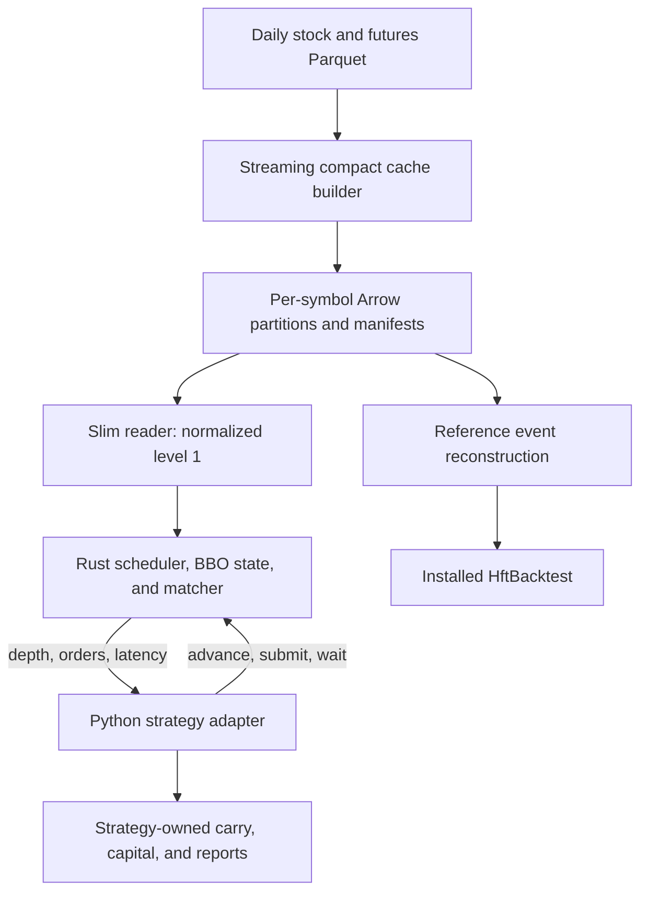

# Slim engine introduction

[Project README](../README.md) · [Package API reference](../hftbacktest_slim/README.md)

`hftbacktest_slim` is the project's strategy-independent replay runtime. It
combines compact Arrow market data, a Python API, and a Rust event scheduler
and immediate-order matcher. It supplies execution primitives; each strategy
owns its decisions, risk, portfolio state, and reports.

The current package is `0.9.0`, with Rust engine `rust-0.5.0`, native ABI `4`,
compact builder `5`, and schemas `bbo_v2` and `top5_v1`. The futures/spot runner
uses result identity schema `13`. Package, engine, ABI, compact schema, builder,
and strategy result identities are versioned separately.

## Choosing an engine

| Requirement | Reference HftBacktest | Slim |
| --- | --- | --- |
| Default futures/spot execution | Yes | Explicit `--engine slim` |
| Immediate crossing FOK/IOC | Yes, with explicit intended semantics | Supported |
| Passive/GTC/GTX or queue research | Reference path | Unsupported |
| Partial-fill or depth-sensitive research | Reference path, with an appropriate model and input | Unsupported |
| Compact Top-N input | Reconstructs every selected level | Projects level 1 only |
| Arbitrary custom `scripts.strategy_api` strategy | Python fallback | Use the reference path until separately validated |
| New strategy using neutral execution primitives | Requires reference integration | Public slim API within its supported profile |

The installed HftBacktest engine remains the regression oracle and default.
The reference Numba scanner optimizes the default futures/spot strategy; its
Python implementation provides the behavioral reference and custom-strategy
fallback. Slim uses the shared Python strategy loop with Rust scheduling,
market state, latency, and matching.

## Data and execution flow



The shared runtime lives entirely under `hftbacktest_slim/`:

| Location | Responsibility |
| --- | --- |
| `native/src/` | Rust scheduler, local/exchange BBO books, order state, matcher, and C ABI. |
| `src/hftbacktest_slim/engine/` | Python engine lifecycle, Arrow projection, native loading, and ctypes binding. |
| `src/hftbacktest_slim/market_data/` | Physical schemas, normalization, timestamps, tradability, validation, and audit. |
| `src/hftbacktest_slim/cache/` | Streaming builder, manifests, cache reuse, resource limits, and atomic publication. |
| `src/hftbacktest_slim/cli/` | Package-owned cache build and read commands. |

Strategy-owned adapters live in `future_spot/arbitrage/`; the reference compact
adapter lives in `scripts/compact_hbt_adapter.py`. The package never imports
strategy code, root HBT helpers, or installed HftBacktest. See the
[migration and dependency contract](HFTBACKTEST_SLIM_MIGRATION.md).

## Matching contract

One engine has exactly two assets. Their latency and tick-size settings are
independent. Each order is an immediate FOK or IOC limit order:

- A buy fills at the exchange best ask when its limit crosses that ask.
- A sell fills at the exchange best bid when its limit crosses that bid.
- An unavailable book or a non-crossing order expires.
- A fill executes the entire requested quantity; displayed size does not cap it.
- Passive orders, cancel/modify, partial fills, and depth-sensitive execution
  are outside the supported profile.

The runtime maintains separate local and exchange books. A strategy observes
local data, while orders match against exchange state at their arrival time.
Feed offset, order-entry latency, and order-response latency are configured
per asset. Raw local timestamps and per-symbol correction metadata preserve
negative-latency correction without applying one global daily shift.

TWSE rows with `trial_status_tag=1` carry `tradable=0`: they clear the books and
disable matching until a later tradable row rebuilds the BBO. Unsupported
execution modes fail explicitly; FOK/IOC must never fall back silently to GTC.

## Clocks and equal timestamps

The strategy clock decides when the strategy evaluates. Ordering decides which
market and order events are processed first when timestamps collide. They are
independent settings, and both affect results.

| Runner option | Behavior |
| --- | --- |
| `--strategy-clock step --step-ms 1000` | Default: process events through each fixed strategy timestamp, then evaluate. |
| `--strategy-clock event` | Slim only: stop after one local feed row and evaluate. |
| `--equal-timestamp-ordering hbt` | Default: preserve HBT-compatible asset/event-kind priority. |
| `--equal-timestamp-ordering sequence` | Slim only: anchor orders after the locally observed source row. |

HBT-compatible ordering uses the equivalent key
`(timestamp, asset_no, event_kind_priority, source_seq)`, with local data,
local order responses, exchange data, and exchange order requests in that order.

Sequence mode orders compact rows by timestamp, asset, and `source_seq`. A
zero-latency order can match after the observed row and before a later row on
the same asset carrying the same timestamp. Waiting for its response returns
without first draining later equal-timestamp rows. Asset priority remains
explicit: `source_seq` is not a global cross-asset arrival sequence.

For example, two rows at timestamp 100 show bids of 110 and then 100. A sell
limit at 110 created after observing the first row can fill in sequence mode.
HBT-compatible ordering can process the later exchange book before attempting
the order, causing expiry. This is a separate semantic baseline, not a parity
failure between identical modes.

Order-response waits, post-first-feed waits, timeouts, and end-of-data remain
explicit execution events. Changing the clock does not create concurrent
strategy decisions during an in-progress order sequence. The runner records
clock and ordering in manifests and relevant audit tables.

## Compact depth and cache safety

`--compact-depth-levels N` selects the same number of levels on both sides,
from 1 through 5. Each row is normalized before selection: remove invalid
price/quantity levels, sum repeated-price quantities, sort bids descending and
asks ascending, then take N distinct prices. Explicit price-only quantity
policies remain available for feeds without depth quantities.

| Selected depth | Schema | Date namespace beneath the cache root |
| --- | --- | --- |
| `1` | `bbo_v2` | `date=YYYYMMDD/` |
| `2..5` | `top5_v1` | `profile=top5_v1/depth_levels=N/date=YYYYMMDD/` |

`top5_v1` has a fixed five-level physical schema. Unavailable levels and fields
above the selected N are null. Depth, profile, and schema participate in cache
identity, so N=2 and N=5 partitions are not interchangeable. Both profiles
project into the same 80-byte native BBO row. The reference adapter reconstructs
all selected levels; slim still matches only level 1.

The builder streams projected Arrow record batches and routes all requested
symbols during at most one successful cold scan per daily stock/futures
source. Validated warm reuse performs zero raw payload scans. Workers consume
compact partitions without reopening raw daily data. Cache reuse checks source
identity, implementation, schema, policies, row/content facts, and completion.

Files are built in a same-filesystem temporary date directory. Closed files
are validated, the manifest is written last, and the date is published by
atomic rename. Failed builds remove only their incomplete temporary partition.
Completed caches, raw data, and results are never automatically deleted.

The default compression is LZ4; `none` and `zstd` are also supported. Resource
preflight uses conservative row estimates of 96 bytes for `bbo_v2` and 256
bytes for `top5_v1`, multiplied by source rows and a 1.20 safety factor. Cache
size defaults to a 200 GB cap with a 200 GB free-space reserve. Checks account
for completed and temporary output and run again after every batch. Adjust
`--compact-cache-max-gb` and `--compact-cache-min-free-gb` explicitly for the
host's storage budget.

See the [Top-N design](COMPACT_TOP_N_DEPTH_PHASES.md) for exact schemas,
metadata, content validation, namespaces, and publication contracts.

## Running the futures/spot adapter

Install dependencies and build the native library from the repository root:

```bash
python3 -m pip install -r requirements.txt
cargo build --workspace --release
```

A default fixed-step BBO run:

```bash
python3 future_spot/test/run_full_backtest.py \
  --engine slim \
  --start-date 2026-03-02 \
  --end-date 2026-03-02 \
  --workers 1 \
  --max-pairs 5
```

An event-clock run with Top-N storage and explicit sequence ordering:

```bash
python3 future_spot/test/run_full_backtest.py \
  --engine slim \
  --compact-depth-levels 3 \
  --strategy-clock event \
  --equal-timestamp-ordering sequence \
  --start-date 2026-03-02 \
  --end-date 2026-03-02 \
  --workers 1 \
  --max-pairs 5 \
  --output-dir future_spot/output/example_slim_n3_sequence_20260302
```

To consume five compact levels through reference HftBacktest instead:

```bash
python3 future_spot/test/run_full_backtest.py \
  --engine reference \
  --market-data-cache compact \
  --compact-depth-levels 5 \
  --start-date 2026-03-02 \
  --end-date 2026-03-02 \
  --workers 1 \
  --max-pairs 5
```

These examples require the configured daily data sources. The default compact
root is `data/tw_compact_v2`; schema/profile/depth select the namespace below it.
Use an explicit output directory when comparing semantic modes. Read
`run_errors.csv` and manifests before interpreting results.

Futures/spot sequencing, second-leg risk handling, exact-contract carry,
capital constraints, and reports belong to the strategy. Slim does not manage
a portfolio or roll positions. The [runner guide](../future_spot/README.md)
documents those policies and the daily opportunity/Lark workflow.

## Using the neutral Python API

Use root-package imports. Point each asset at an existing compact partition;
the paths below are illustrative. Latencies use integer nanoseconds, and tick
sizes must match the actual instruments.

```python
from hftbacktest_slim import AssetConfig, Side, SlimEngine, TimeInForce

assets = [
    AssetConfig(
        symbol="0050",
        data_path="/data/compact/0050.arrow",
        tick_size=0.05,
        order_entry_latency_ns=1_000_000,
        order_response_latency_ns=1_000_000,
    ),
    AssetConfig(
        symbol="NYF",
        data_path="/data/compact/NYF.arrow",
        tick_size=1.0,
    ),
]

with SlimEngine(assets, equal_timestamp_ordering="hbt") as engine:
    if engine.advance_to_next_feed():
        depth = engine.depth(0)
        if depth.best_ask > 0:
            engine.submit_order(
                asset_no=0,
                order_id=1,
                side=Side.BUY,
                price=depth.best_ask,
                quantity=10,
                time_in_force=TimeInForce.FOK,
            )
            if engine.wait_order_response(0, 1, 50_000_000):
                order = engine.order(0, 1)
                print(order)
```

`advance(ns)` provides bounded fixed-step advancement;
`advance_to_next_feed()` stops after one local feed row. They return `False`
when their documented end-of-data conditions apply. `depth()`, `order()`,
`feed_latency()`, and `order_latency()` return immutable views, with order state
visible after its response. Context-manager exit closes the engine.

On Linux, the workspace build produces `target/release/libhbt_slim.so`. Library
selection checks explicit `library_path=`, `HFTBACKTEST_SLIM_LIBRARY`, a packaged
artifact, then the repository release artifact. Loading checks ABI compatibility;
package import alone does not load the native library. Full API, typed errors,
standalone installation, and cache CLIs are in the
[package reference](../hftbacktest_slim/README.md).

## Validation and interpretation

The combined `0.9.0` integration passed 325 Python tests and 17 Rust tests,
including package isolation, external installation, equal-timestamp collisions
on Top-N input, level-1 projection, and carry/restart regressions. The root
[validation commands](../README.md#validation) reproduce the code checks.

The [Phase 5 report](COMPACT_TOP_N_PHASE5_VALIDATION.md) records earlier
version-specific evidence: exact direct/compact reference events for N=1..5,
a complete 157-pair slim N=1/N=3 comparison, and a bounded real carry/restart
run. It also documents diagnostic reference/slim differences and benchmark
scope. Those measurements do not establish new `0.9.0` sequence-mode
performance, annual parity, or a full-program acceleration result.

Compare runs only when source identity, date/pair universe, engine, clock,
ordering, latency, strategy settings, carry, capital, and output mode are
aligned. Remaining rollout gates and benchmark requirements are defined by the
[acceleration strategy](HBT_ACCELERATION_STRATEGY.md).
